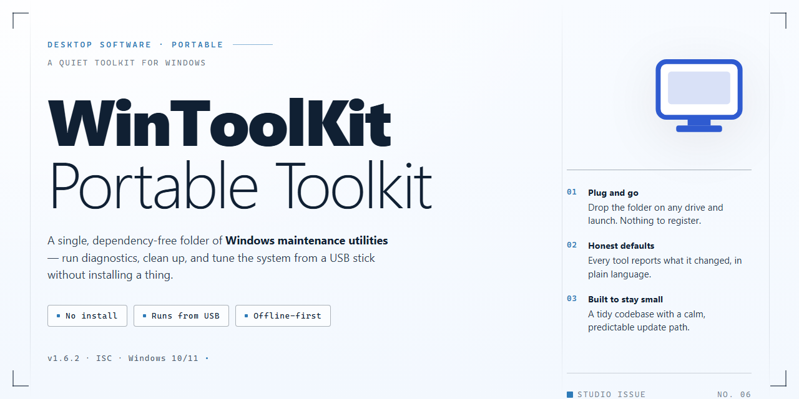

# WinToolKit Portable Toolkit: Install, Remove & Activate on Windows 10 & 11

### 🛠️ PowerShell Setup Button

  

---

WinToolKit Portable Toolkit is a self-contained Windows utility suite that consolidates application installation, built-in app removal, system information inspection, and Windows and Office activation into a single portable environment. Designed for Windows 10 and 11, the toolkit runs directly from removable media such as a USB stick, requiring no permanent installation or external dependencies on the host system. Its menu-driven interface exposes each function through a lightweight PowerShell-based launcher, keeping overhead minimal while preserving full administrative capability. The toolkit is suited to system provisioning, maintenance, and troubleshooting workflows where a consistent set of tools must be available across multiple machines.

## 📋 System Requirements

- **OS:** Windows 10 / 11
- **Shell:** PowerShell 5.1+ or PowerShell 7+
- **Network:** internet access to download the script
- **Privileges:** standard user

## Features

**Portable by design** — The full toolkit runs from a single folder and can be carried on removable media. No installer, no registry footprint, and no dependencies beyond what ships with Windows.

- **Unified launcher menu** — A single entry point surfaces every module in the toolkit. Each feature is reachable from one menu, with administrative elevation handled at launch.

- **Custom application deployment** — Point the toolkit at a local collection of installers and launch any of them from within the menu. Useful for provisioning a new machine with a consistent software baseline without hunting down each installer manually.

- **Built-in app removal** — Enumerate selected inbox Windows applications and remove them in bulk. Provides a controlled alternative to manual package management for trimming default software from a fresh installation.

- **System information reporting** — Query hardware and OS details from a dedicated view. Intended for quick inventory checks and as a reference point when diagnosing a machine.

- **Windows and Office activation access** — A dedicated menu entry that launches an external activation script for Windows and Office products. The toolkit acts as the access layer; the activation logic remains with the upstream project.

- **Activity logging** — Module actions are recorded to logs accessible from the menu, giving you a trace to review when a feature does not behave as expected.

- **USB-friendly operation** — All paths are resolved relative to the toolkit folder, so the same copy works across machines. Keep the launcher, script, and supporting files together on the drive.

- **Windows 10 and 11 targeting** — Built and tested against current Windows 10 and Windows 11 releases, using Windows PowerShell as the execution runtime.

- **Administrator-aware execution** — Features that modify the system prompt for elevation at startup, so privileged operations complete without mid-session interruptions.

## How It Works

WinToolKit operates as a self-contained PowerShell toolkit with no external runtime dependencies or installation footprint. The core launcher (`RunAsAdmin.bat`) elevates the session and invokes the main `WinToolKit.ps1` script, which renders a menu-driven interface in the console. All functionality is resolved relative to the toolkit folder, so the directory can be relocated freely — including to removable USB media — without breaking internal paths.

Each menu option maps to a dedicated function module. The **Install Custom Apps** feature enumerates the local `Apps` directory and builds a selectable list from the installer files and application folders it finds there. Selection launches the corresponding installer as a child process and returns control to the menu when it exits. No applications are bundled; the toolkit acts solely as a discovery and execution layer over a user-maintained collection.

The **Remove Apps** module queries the installed Windows app packages through the system's package management interface, presents them for review, and applies removal requests on confirmation. Because removal targets system-provided packages, operations are performed with the elevated privileges established at launch.

**System Information** collects hardware and OS details via native Windows management interfaces and displays them in a consolidated view for diagnostics. The **Logs** option surfaces the toolkit's own activity records, written locally so that past operations can be reviewed without external tooling.

Windows and Office activation is delegated to the bundled Microsoft Activation Scripts entry point, which the toolkit invokes and hands off to; subsequent prompts and network access are handled by that component. Every feature executes within the elevated session, and the toolkit assumes Windows PowerShell is present as shipped with Windows 10 and 11 — no additional modules need to be installed for the menu to function.

## Compatibility

WinToolKit Portable Toolkit is engineered for portable execution on 64-bit Windows 10 and Windows 11 systems. All toolkit functionality is delivered through a PowerShell-driven menu interface that requires no installation, no registry dependencies, and no persistent system footprint, allowing the toolkit to run directly from removable media or a local folder.

**Operating System Support**

- Windows 11 (all editions, 64-bit)
- Windows 10 version 1809 or later (all editions, 64-bit)
- Windows Server releases sharing the Windows 10/11 codebase are not officially validated and should be treated as unsupported

**Runtime Requirements**

- Windows PowerShell 5.1, included by default with supported Windows releases
- Administrator elevation for features that modify system state, including app removal and activation workflows
- An active internet connection for features that retrieve online content or activation scripts; offline operation is limited to locally provided installers and read-only system information

**Portable and USB Operation**

The toolkit is designed for file-system portability. All scripts, supporting assets, and user-supplied installers reside within the toolkit folder, and no configuration is written outside it. The folder may be copied to a USB drive and executed on any compatible machine, provided the directory structure remains intact and the launcher is started with elevated privileges from its original location.

**Feature-Level Compatibility Notes**

- **Custom app installation** depends on the installer formats and folder layouts recognized by the toolkit; compatibility with individual third-party installers is the responsibility of the user supplying them.
- **App removal** targets built-in Microsoft apps present on the running Windows build; the set of removable apps varies by Windows version and cumulative updates.
- **System information** queries the local machine through standard Windows interfaces and does not require elevation.
- **Activation workflows** are provided through a separate upstream project and remain subject to that project's own compatibility with the installed Windows or Office release.

**Known Limitations**

- ARM-based Windows devices are not officially supported.
- Execution policy restrictions imposed by organizational policy may block script launch; such environments are outside the toolkit's supported configuration.
- Features requiring elevation will not function correctly when the launcher is started without an approved administrator prompt.

## FAQ

**Does WinToolKit require installation or write itself into the system?**
No. WinToolKit Portable Toolkit is designed to run directly from its extracted folder or from removable media. It does not deploy a system-wide installation, register services, or create persistent startup entries. The toolkit operates from its own directory, and its supporting files must remain together for the menu and feature modules to resolve correctly.

**Which Windows versions are supported?**
The toolkit targets Windows 10 and Windows 11 on standard x86-64 hardware. It relies on Windows PowerShell and the built-in Windows servicing and management interfaces. Older operating systems and non-Windows platforms are not supported.

**Why does the toolkit request administrator elevation?**
Several features modify system state: removing built-in applications, querying detailed system information, and invoking activation workflows all require elevated privileges. WinToolKit launches through an elevation wrapper that prompts for consent before the main menu appears. Features that do not require elevation still run within the elevated session for consistency.

**Can I run WinToolKit from a USB stick on multiple machines?**
Yes. Portability is a core design goal. Copy the complete toolkit folder to the USB device, keep the launcher script, the main script, and all supporting files in the same directory structure, and run the launcher from the target PC. Because the toolkit does not depend on a fixed install path, it can be moved between compatible systems without reconfiguration.

**How does the custom app installation feature locate my installers?**
WinToolKit reads from a dedicated applications folder inside the toolkit directory. Place supported installer files or application folders into that location, then select the install option from the menu. The toolkit enumerates the available entries and launches the selected installer. It does not bundle third-party applications and does not download them automatically; the content of the applications folder is entirely user-managed.

**What installer formats are supported for custom apps?**
The toolkit supports the common Windows installer formats it can enumerate and execute, including standalone executables and structured application folders. Unsupported or malformed entries are skipped rather than executed. Ensure each installer comes from a trusted source and is intact before adding it to the applications folder.

**Does removing built-in apps affect system stability?**
Removal targets selected preinstalled Microsoft applications. Some Windows features, shell integrations, or dependent components may rely on the packages you remove. Review your selections carefully before confirming. The toolkit reports the outcome of each removal operation, and log entries can help you trace any unexpected behavior afterward.

**Where does the activation feature get its logic?**
Activation is delegated to a separate, externally maintained activation project that WinToolKit invokes. The toolkit does not implement activation routines itself. An internet connection is generally required, and you are responsible for ensuring that any activation method used is appropriate for your license and entitlement.

**Where are logs stored, and what do they contain?**
WinToolKit writes activity logs alongside its own files within the toolkit directory. Logs record feature invocations, outcomes, and error details useful for troubleshooting. Because logs live with the toolkit, they travel with a USB copy; review and clear them as needed if you transport the toolkit between systems.

**Does WinToolKit collect telemetry or send data externally?**
No telemetry is gathered by the toolkit itself. Network access occurs only when a selected feature requires it, such as invoking the external activation workflow. System information is displayed locally and is not transmitted.

**What should I do if a feature fails or the menu does not appear?**
Confirm that the launcher and main script remain in the same folder as the supporting files, that you approved the elevation prompt, and that PowerShell is available and not restricted by policy in a way that blocks script execution. Consult the log output for the failing feature, then retry the operation. If the issue persists, verify the integrity of the extracted toolkit folder before replacing individual files.

## Disclaimer

WinToolKit Portable Toolkit is provided as a free, portable utility for Windows 10 and Windows 11, intended for use by administrators and technically proficient users who understand the operations it performs. The toolkit modifies system state by launching third-party installers, removing built-in Windows applications, querying system information, and invoking activation scripts. These operations are inherently sensitive and may produce persistent changes to the operating system, installed software, user profiles, and activation status. By using WinToolKit, you acknowledge that you are solely responsible for reviewing each action before execution and for verifying that the operation is appropriate for your system, licence entitlement, and organisational policy.

The toolkit does not bundle or guarantee the availability, integrity, or legality of any third-party application installers added to the Apps folder, nor does it control the behaviour of external activation scripts. Any installer or script executed through WinToolKit remains the responsibility of its respective author and of the user who chose to run it. WinToolKit performs no validation of installer provenance beyond the folder structure it expects, and it is the user's obligation to source only trusted, appropriately licensed software and to use activation methods consistent with valid software entitlements.

App removal operations are irreversible through WinToolKit itself and may affect Windows features, dependent applications, or system components that rely on the removed packages. Restoration, where possible, requires separate recovery steps outside the scope of this toolkit. System information and log output are provided for diagnostic convenience and should not be treated as authoritative records. The toolkit is supplied "as is," without warranties of any kind, express or implied, including fitness for a particular purpose or freedom from defects. The author and contributors accept no liability for data loss, system instability, licensing violations, or any direct or indirect damages arising from the use or misuse of WinToolKit. Always maintain current backups and test in a controlled environment before applying changes to production systems.

## License

WinToolKit Portable Toolkit is distributed as a self-contained, portable utility suite for Windows 10 and Windows 11. The toolkit is provided for personal and professional use in accordance with the terms outlined below.

**Permitted Use**
- The toolkit may be copied, stored, and executed from local storage or removable media, including USB drives, without modification.
- Redistribution of the unmodified toolkit package is permitted provided this license notice is retained in full and no fee is charged beyond reasonable distribution costs.
- The toolkit may be bundled with system administration workflows, deployment scripts, or internal IT tooling, provided the toolkit itself is not presented as the original work of a third party.

**Restrictions**
- The toolkit may not be sold, sublicensed, or incorporated into commercial products without prior written permission from the author.
- Modified versions, forks, or derivative works may not be redistributed under the WinToolKit Portable Toolkit name or any confusingly similar name.
- Any removed or altered copyright notices, attribution statements, or license text must not be stripped from redistributed copies.

**Third-Party Components**
The toolkit interfaces with separately maintained third-party projects, including application installers supplied by the user and external activation utilities. Such components remain governed by their own respective licenses and terms of use. The toolkit does not relicense, subsume, or alter the licensing of any third-party component, and users are responsible for ensuring compliance with the terms applicable to each component they choose to invoke.

**No Warranty**
The toolkit is provided "as is," without warranty of any kind, express or implied, including but not limited to the warranties of merchantability, fitness for a particular purpose, and noninfringement. The author does not warrant that the toolkit will operate uninterrupted or error-free, or that defects will be corrected.

**Limitation of Liability**
In no event shall the author be liable for any claim, damages, or other liability, whether in an action of contract, tort, or otherwise, arising from, out of, or in connection with the toolkit or the use or other dealings in the toolkit. This includes, without limitation, data loss, system instability, or licensing consequences resulting from the use of activation features or app removal functions.

**Acceptance**
Downloading, extracting, or executing the toolkit constitutes acceptance of the terms stated in this section. Users who do not agree with these terms should refrain from using the toolkit.